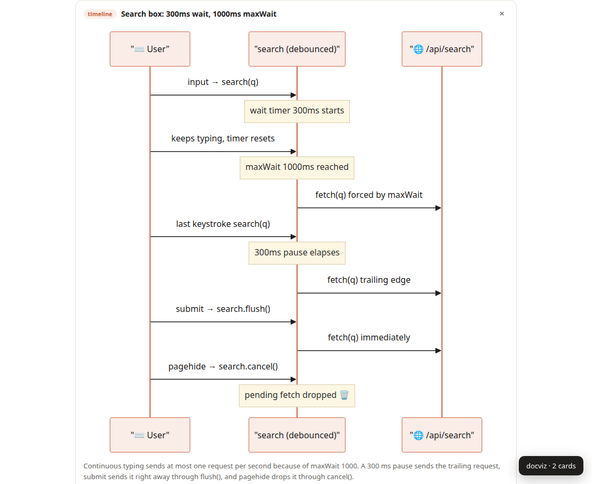
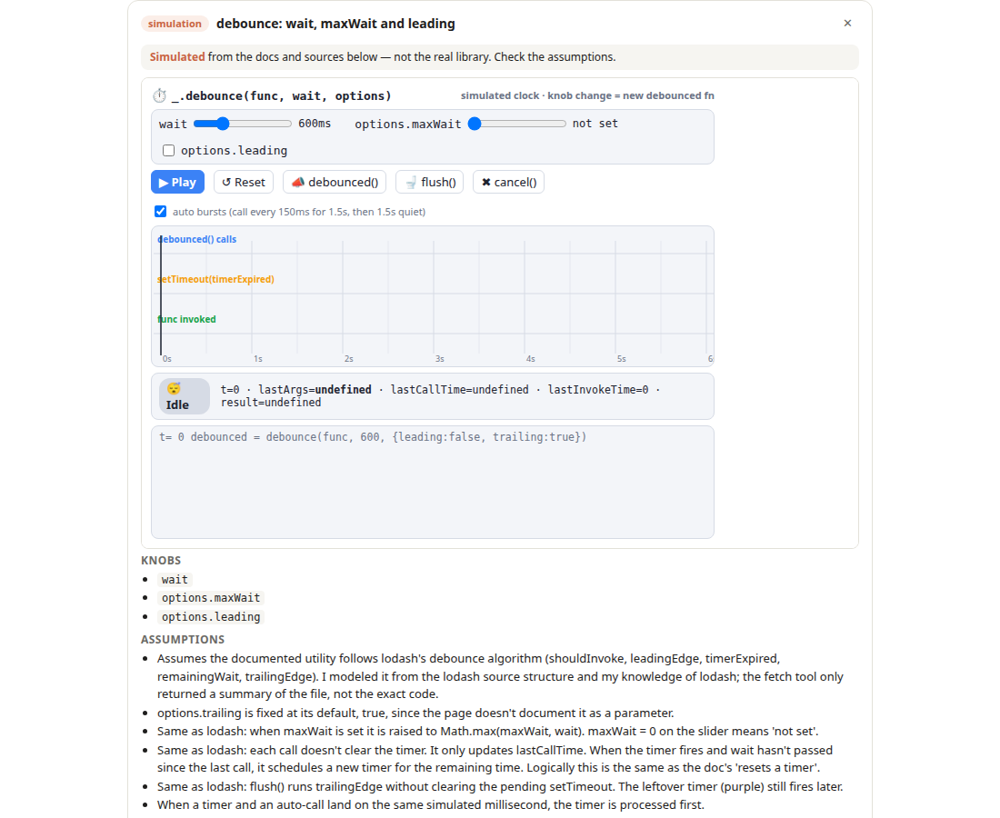

# docviz

See how documented code **behaves**. Break down any docs page into inline diagrams, visualize
any selection (docs, generated code, a README), and turn a diagram into an interactive
simulation grounded in the library's real source — all on your own Claude Code or Codex login.





## Setup (2 minutes)

**1. Start the helper** in a terminal where `claude` or `codex` is logged in. Once, clone and
put `docviz` on your PATH (it isn't on npm yet):

```bash
git clone https://github.com/DerekHertz/docviz.git && cd docviz && npm link
```

Then:

```bash
docviz serve
```

Or, inside Claude Code with the plugin installed, run `/docviz`. Either way it prints a pairing code.

**2. Load the extension.** `chrome://extensions` → Developer mode → **Load unpacked** →
the `extension/` folder. From WSL, that's
`\\wsl.localhost\Ubuntu\home\<you>\docviz\extension`.

**3. Pair.** The setup page opens on install. Paste the code, pick your preferences, done.

### Claude Code plugin (optional)

```bash
claude plugin marketplace add DerekHertz/docviz
```

```bash
claude plugin install docviz@docviz
```

Then `/docviz` starts the helper in the background and shows the pairing code.

## Using it

| Do | Get |
|---|---|
| Toolbar icon or `Alt+Shift+D` | Cards under each section that describes behavior + the side panel |
| Select text → right-click or `Alt+Shift+V` | A popover diagram for just that selection |
| **Simpler / More detail** on a card | Regenerates that card *and* nudges your saved depth (shown on the card, with Undo) |
| **Type ▾** | Redraw as sequence / state / flow / timeline / architecture |
| **Explore ▸** | An interactive simulation with the doc's real knobs. Takes 1–3 min: it reads the source first. Always labeled *simulated*, with sources and assumptions |

Preferences (depth, style, coverage, think-first) live in the side panel and settings page.

## How it works

```
Chrome tab                Extension (MV3)              Local helper
content.js  ──sections──▶ background.js ──HTTP──▶      helper/server.js ──▶ claude -p | codex exec
card iframes ◀──specs──── cache + prefs  ◀──JSON──      (your existing CLI login)
```

- The helper listens on `127.0.0.1:47823`, accepts only `chrome-extension://` origins, and
  requires the pairing code. Page text goes to your CLI and nowhere else.
- `claude -p` runs lean (no MCP servers, skills, or user settings) — ~1k tokens of overhead
  instead of ~90k, about 3× faster.
- Cards render inside extension iframes, so page CSS/CSP can't break them. Simulations run in a
  manifest sandbox page: opaque origin, CSP blocks all network.
- Results are cached per URL + content + preferences.

See [SPEC.md](SPEC.md) for the decisions behind all of this.

## Helper options

```
docviz serve [--port 47823] [--host 127.0.0.1] [--provider auto|claude|codex] [--model M] [--new-code]
docviz code     # print the pairing code
```

## Troubleshooting

- **Red `!` on the toolbar icon** — helper isn't running or isn't reachable.
- **"Pairing code rejected"** — run `docviz code` and paste it into settings.
- **"Can't access this tab"** — the side panel button only works on tabs where you've used the
  toolbar icon or shortcut once (that's the `activeTab` permission at work).
- **Diagram shows as source** — Mermaid couldn't parse it even after one automatic repair.
  Hit **Type ▾** or **Simpler** to regenerate.
