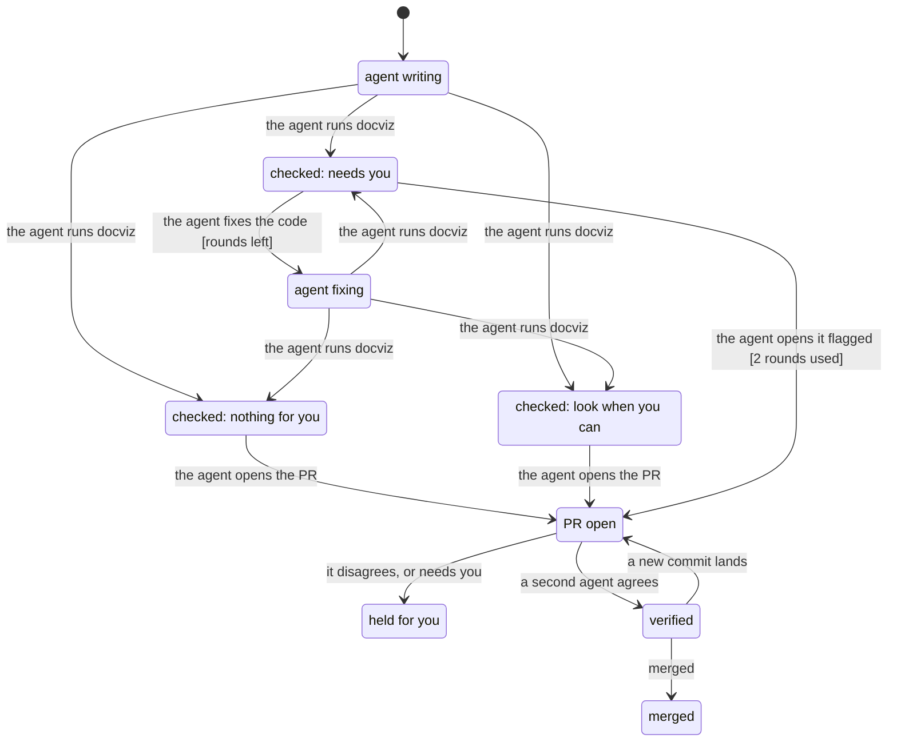

# docviz MVP: the verification flow

Settled in a `grill-the-flow` session on 2026-10-31. The model and its check live in
[mvp-verification/](mvp-verification/).

## Product

- **Who:** a solo builder whose agents write most of the code. The user is the first one.
- **The moment:** "my agents landed 1,000 lines. What changed in how my system behaves, and is
  anything broken?" Today docviz assumes someone reads every PR; the MVP tells them which ones need them.
- **Order:** A, the PR comment, is the MVP's walking skeleton. B, the local atlas page served by the
  `docviz` CLI, comes next, after a visual design pass (references: April Zhu's Field Notes and
  colorfigures, statechart-art). C, a daily digest, follows; a Tauri shell or a Claude Code pane is
  chosen then. The extension comes after the MVP. No desktop app in the MVP.

## Requirements

Functional (each becomes a feature in `verify-docviz`'s map):

1. On a PR, docviz names the modules that moved (import map, base vs head).
2. For each module with a model in the target repo's `.atlas/models/`, it shows the behavior change
   as a statechart with the change drawn on top, and checks the user's rules with TLC.
3. It gives one verdict with its reasons: **needs you** (a rule breaks or a step is contradicted),
   **look when you can** (behavior changed, or anything unknown), **nothing for you** (structure
   only, every step confirmed). Unknown always falls toward "needs you".
4. The comment carries the diagram, the verdict, the reasons and the cost.

Non-functional:

| | Target |
|---|---|
| Cost | docviz's own spend per PR under $0.05 (Jev, any fallback call). The authoring agent's tokens are in its own session. TLC is local. |
| Speed | docviz adds at most 60 s to the authoring agent's loop; the independent rerun finishes within 3 min. |
| Privacy | Code goes only to the user's subscriptions and, for Jev, TypeSafe. Jev is on for the user's repos, optional for anyone else (off without a key), and each repo can turn it off in `.atlas/`. |
| Reliability | The same PR at the same commit gives the same verdict. Map and TLC are exact; Jev's decisions changed in at most 5% of lab cases between runs. |

Storage: `.atlas/` in each target repo, versioned with its code: `rules.md` (the user's sentences),
`models/` (one TLA+ model per stateful module, each step linked to its code). Start with one or two
modules per repo; docviz's first is the card and its money (`prototype/pr1-pipeline/`).

## Flow

```text
in the authoring agent's loop, before it opens the PR:                 (shift left)
  moved = import map(base) vs import map(head)                         [code]
  for each model in .atlas/models whose linked code the PR touched:
    update the model in this PR                                        [agent]
    TLC: the user's rules in .atlas/rules.md, on base and on head      [formal]
    each step: shown by its code? contradicted?                        [Jev, optional]
  verdict:
    a rule breaks, or a step is contradicted   → needs you (path shown)
    behavior changed, or anything unknown      → look when you can
    structure only, every step confirmed       → nothing for you
  if needs you: fix the code and rerun, at most 2 rounds;
                never edit .atlas/rules.md; if it still breaks, open the PR flagged
  comment = diagram + verdict + reasons + cost (docviz pr)               [code]

after the PR opens:
  a verifier that didn't write it reruns docviz → same verdict, ≤ 3 min [agent]
  PASS → merge per pstack's Shipping playbook
```

## The user's rules

1. "Nothing for you" only when no rule breaks and every step is confirmed. Anything unknown counts
   as "look when you can" or worse.
2. An agent never edits `.atlas/rules.md`.
3. A PR merges only with a `PASS` from an agent that didn't write it.
4. The fix loop before opening the PR runs at most 2 rounds, then the PR opens flagged.
5. A PR that still breaks a rule is never opened as anything less than "needs you."
6. Every model call docviz makes shows up in the comment's cost.

More rules get added as they come up.

## Checked

TLC reached 414 states; all six rules hold, and the flow has no deadlock. The chart draws 9 states
and 14 arrows; it hides the step where an agent edits `rules.md`, which changes no chart state.



The rules are not vacuous: three deliberate breaks were each caught by the rule meant to catch them.
Ignoring "unknown" in the verdict broke rule 1; merging without a `PASS` broke rules 3 and 2;
opening a flagged PR as "look when you can" broke rule 5. Rules 4 and 6 were not mutation-tested.

## What the model leaves out

- Real check outcomes: TLC tries every combination of rule break, contradiction, unknown and
  behavior change, so it checks the flow's logic, not whether docviz computes them right. That is
  the verification skill's job (below).
- How docviz detects an agent edit to `rules.md` (modelled as: such a PR never merges).
- Stacks of PRs, the comment's content, cost amounts, timing.
- Jev's answers moving between author and verifier are modelled; TLC's are not (it is exact).

## How docviz itself is verified

`verify-docviz` (to be generated with `/pstack:create-verification-skill` into `.claude/skills/`,
which needs the user's approval) drives the flow end to end:

- A fixture repo with 6–8 planted cases of known truth (a rule-breaking PR, a no-op refactor, a
  behavior change with rules holding, a model contradicting its code). CI runs them on every PR with
  recorded Jev answers.
- 3–5 real past PRs replayed with live Jev, verdicts labelled by the user: docviz PR #1 (the dismiss
  gap) and dimsumden candidates #268 (→ #275) and #309 (→ #310), among #325, #437, #256/#267.
- A `PASS` means every planted case gets its exact verdict, every real case its labelled verdict, and
  the cost, time and rerun targets hold.

## Rerun the check

```bash
cd docs/flows/mvp-verification
TLA2TOOLS=<tla2tools.jar> JAVA=java \
  "$(find ~/.claude/plugins/cache -path '*statechart/scripts/statechart')" \
  Flow.tla --config Flow.cfg --view view.mjs --out out-new
```
