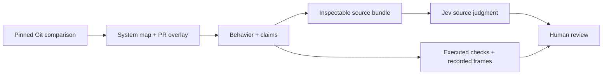

# Docviz architecture and verification

Docviz lets a reviewer move from a system map to a changed behavior, its claim, the relevant code, and the evidence behind a decision. The map is a source interpretation. Each kind of evidence retains its own scope and provenance.

The standalone studio is the current behavior-first review surface. The legacy `docviz pr` CLI produces GitHub-ready comments. The Chrome documentation extension and GitHub review extension remain separate surfaces; a studio check does not establish that either extension works in Chrome.

## The review flow

A cached map stores component responsibilities, ports, pseudocode, source anchors and connections for an exact repository and revision. A new change can reuse those descriptions and overlay changed components. Claims, Jev judgments, test results and human decisions belong to their own comparison. Reusing a description supplies no fresh behavior evidence.

A prepared behavior adapter can show recorded inputs and outputs at two tool or product revisions. Playback steps through recorded frames. Modules without a matching scenario show source explanations and missing evidence. The curated map can omit modules or dependencies; unmapped changes remain gaps.

## Who owns each part

| Module | Responsibility |
| --- | --- |
| `git.mjs` | Resolve comparisons, read immutable Git blobs, collect diffs, and identify supported source imports. |
| `system-maps.mjs` | Validate and persist immutable source maps; compare revisions and identify changed or reused descriptions. |
| `stack.mjs`, `coverage.mjs` | Load canonical artifacts and bind captures or contract results to the correct repository, base, head and layer. |
| `review.mjs` | Validate proposals, define review policy, compute document digests, and produce receipts and handoffs. |
| `workspace.mjs` | Persist documents, producer artifacts, evidence and decisions through one serialized writer. |
| `source-context.mjs` | Select bounded, inspectable context from pinned source for a claim. |
| `agents.mjs` | Request author/reviewer/verifier contributions and optional Jev source judgments. |
| `server.mjs` | Serve the loopback UI, validate domain actions and retain asynchronous job status. |
| `ui/` | Render the system, behavior comparisons, source packets, evidence, findings and human decisions. |
| `helper/pr.js`, `helper/verdict.js` | Run the CLI review and rank source, model and contract findings into its headline. |
| `helper/contracts.js`, `helper/contracts/` | Apply an operator-selected contract profile and execute registered, explicitly trusted scenarios. |

## What Jev verifies

The studio asks Jev three questions about a claim and the source actually supplied:

1. Is the context sufficient to establish the claim or directly refute a material clause?
2. Does that source support every material clause?
3. Does it directly contradict a material clause?

The adapter validates the returned scores. With the existing `source-context-v2` policy, context below 0.6 produces uncertainty. With sufficient context, contradiction at or above 0.5 takes precedence, then support at or above 0.6. Other valid answers remain inconclusive. Invalid answers stay unknown. These scores and cutoffs are a review policy, not calibrated probabilities that the software is correct.

The legacy CLI also uses Jev to compare authored steps and model actions with their cited code. Its step-check adapter has its own request and decision policy in `helper/checks.js`. The studio's three-question context gate does not silently change that older policy.

Jev currently contributes source compatibility judgments. A factual claim about a particular execution still needs execution evidence. Source inspection, including a test's assertion, does not establish that the assertion ran or that every runtime path satisfies it. Jev does not currently provide an exhaustive coverage proof, calibrated PR risk score or security certification.

## How source context is assembled

The original studio sent at most four narrow anchor slices. Real claims referenced validators, thresholds, registry entries and invocation code outside those slices. The preserved live run exposed this gap.

The bounded selector starts with the complete modules containing a claim's anchors. Declared supporting component code supplies context for relationships imports miss, such as a registered child-process device. Supported relative imports add nearby dependencies under file, byte and depth limits. The selector reads Git objects through the existing source boundary; it executes no reviewed code.

Each judgment retains the claim definition digest and the exact submitted source packet, its version and fingerprint. The packet records file sides, commits, blobs, ranges, inclusion reasons and omissions. The UI exposes that packet beneath the assessment. An unavailable seed produces an explicit incomplete check rather than a fictitious Jev response. Budget limits and unsupported relationships remain visible; a populated packet is not a completeness certificate.

Full modules recover same-file definitions and complete function bodies. Import expansion does not discover every caller, computed path, governing rule, runtime setting or historical target. Those can require declared support or another evidence layer. A complete current-tool module cannot by itself prove what happened on frozen PR #1.

## How the implementation is tested

| Layer | What it establishes | Practical limit |
| --- | --- | --- |
| Syntax checks | The checked JavaScript modules parse. | They do not establish behavior. |
| Unit and integration regressions | Particular inputs produce expected validation, persistence, classification and UI output. Negative controls distinguish a correct result from a false pass. | Coverage is the cases and assertions actually run. Intercepted provider answers test routing, not model accuracy. |
| Real CLI and helper HTTP checks | The user-facing process produces the expected comments, verdicts, source links and HTTP responses on pinned fixtures. | Local environment, tools and fixtures affect the result; unavailable cases remain skipped. |
| Registered contract execution | An independently controlled scenario observes specific behavior from committed target code. | One supported consumer and finite scenario do not establish every module behavior. |
| TLC model checking | Declared invariants hold or fail in the checked model and its stated bounds, with counterexample paths. | The model can omit behavior. Jev's action/code checks and targeted code replays support alignment; TLC does not prove arbitrary application code matches the model. |
| Canonical capture and binding checks | Displayed evidence agrees with its content-bound artifact and exact comparison. Stale or incompatible captures cannot play as current observations. | Fingerprints establish integrity, not authorship or that supplied data was honestly obtained. |
| Live Jev controls | The real endpoint can distinguish the declared control cases and reports uncertainty under the current source policy. | A smoke run is not an accuracy estimate. All results, including uncertainty and failures, must be retained. |
| Browser interaction checks | The actual viewer exposes the expected flows, playback, pinned source and evidence controls at the checked sizes. | A scripted click-through does not establish every browser, accessibility path or extension behavior. |
| Independent review | A separate agent challenges the implementation and runs it through its real interfaces. | The review has a declared scope; green tests and agent agreement are not human acceptance. |

## The missed-contract regression

The author's historical PR #1 summary omits dismissal and late-return accounting. The selected accounting profile applies from changed paths independently of that summary. At the exact trusted target, the scenario draws a card, receives a paid failure, retries, dismisses while the call is out, and returns another paid result. The replay exposes a ledger total that includes a late charge while the page carries none of it. The new reviewer prints **Needs you**.

The observer runs separately from the reviewed background. It accepts controlled storage/fetch activity and the actual `panel:get` reply rather than stdout that declares a pass. A reviewer-owned registry identifies the supported panel by its committed module bytes. Docviz projects that panel's calculation over the reply; it does not run its DOM or observe Chrome refresh timing. Pending observed timers or extra unresolved requests withhold judgment. Other asynchronous paths, test-aware code and permission-model escapes remain outside that observation.

This selected-profile regression demonstrates an important omitted behavior. It does not revise the preserved blind historical calibration or establish that every consequential contract will be found automatically.

## How a review becomes a decision

Agent-authored responsibilities and properties remain proposals. A separate reviewer can challenge them with source anchors, reasons and distinguishing checks. Component boundaries and consequential property definitions need human confirmation for a behavioral review.

Evidence retains its producer and scope: source judgment, executed assertion, bounded model result or reported audit. A command's successful exit is command-level evidence; property-level observations require explicit recorded assertions. A property edit makes an answer for its prior definition historical. New commits need current source and captures; additional evidence changes the review digest.

The human records component/property decisions, dispositions for findings, scope, rationale and accepted limitations. The receipt binds that decision to the comparison and evidence IDs. It is a local review record, not an authenticated signature or universal correctness guarantee. PR #18 remains for the user's review; this studio does not merge it automatically.

The server binds to `127.0.0.1` and validates Host, Origin and a per-process mutation token. Jev's key stays in the operator-started server environment. Source and runtime review data can contain project code and remain outside committed application source.
