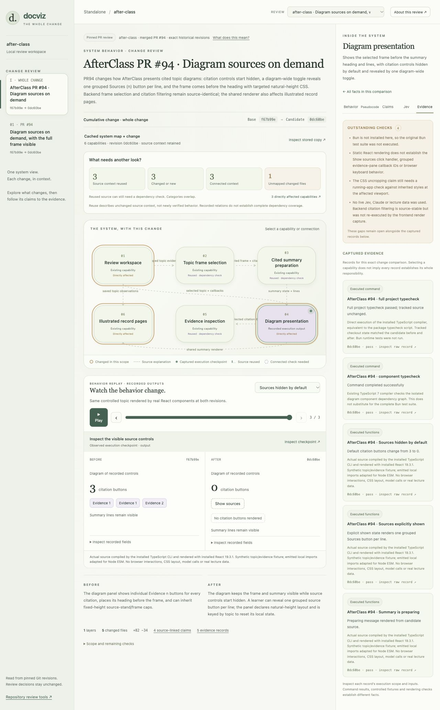

# Review changes with Docviz

The standalone studio lets you review a system map, zoom into a change or a layer of a PR stack, and follow behavior through pseudocode, exact code, claims and evidence. Saved source context is separate from verification.

## Start the studio

From the Docviz repository root, generate the example and its cached baseline:

```bash
node tools/review-studio/examples/stack/prepare.mjs \
  "$PWD" "$PWD/.scratch/review-studio" "$PWD/.scratch/review-captures"
npm run review:studio
```

Open [the stack explorer](http://127.0.0.1:47840/stack.html). On macOS, you can also use `Launch Stack Studio.command` in this folder after generating the example. Node.js 22 or newer and Git are required. The studio has no package dependencies.

The example reconstructs actual merged Docviz PRs #13–15. **Whole stack** compares the original target with the stack tip. Each layer compares its own parent and candidate. Click a capability for its inputs, outputs and source explanation. Follow **Pseudocode** to exact Git source, then inspect **Claims**, **Jev** and **Evidence**. Play recorded checkpoints or use the timeline.

The 12 function captures use actual historical exports with controlled upstream findings. Three captured regression commands have 43 passing cases. They do not execute live TLC or Jev. No approval is recorded by viewing the explorer. The capture process uses isolated snapshots and confines import-time caches to its capture folder.

## Try another PR against the cached map

To prepare Docviz #16 and AfterClass #94, supply an existing AfterClass checkout with its TypeScript and React dependencies installed:

```bash
node tools/review-studio/examples/stack/prepare-trials.mjs \
  "$PWD" /absolute/path/to/AfterClass \
  "$PWD/.scratch/review-studio" "$PWD/.scratch/pr-trial-captures"
```

For Docviz alone, append `--docviz-only`; the AfterClass path is then unused. The adapter does not install dependencies or call model providers. The review selector lists generated comparisons.

Use **Source context reused**, **Changed or new**, **Connected context** and **Unmapped changed files** to inspect the overlay. Filters retain surrounding context. Expand a claim for **What needs reverification**. Inspect **Evidence → Outstanding checks** for missing runtime checks. Recorded checkout and citation-control diagrams project captured fields; raw values remain inspectable.

Docviz #16 reuses five descriptions and updates one. Its controlled replay selects the requested checkout after the change. The recorded regression command has 66 passes and 14 skips. AfterClass #94 reuses three descriptions and updates three. Actual React static renders show hidden and grouped citations. Browser interactions, CSS layout and Bun tests remain open. A separate full-project typecheck passed on the tested AfterClass checkout; the adapter captures only its component typecheck.

## Reuse the stored system map

Immutable snapshots live under `dataRoot/system-maps`. **Inspect stored copy** shows the revision, model ID and source fingerprints. New comparisons reference an exact baseline in the registered repository and overlay changed descriptions and connections. Competing models require an explicit map ID. There is no global latest-map fallback.

Reused descriptions do not inherit claims, Jev results, tests or human decisions. Changed source, changed contracts and changed connections remain distinct. Recorded downstream connections identify potentially affected context; unmapped changes remain coverage gaps. The supplied graph is a partial source interpretation, not automatic exhaustive dependency discovery.

## Test Jev before merge

Set `TYPESAFE_API_KEY` only in the local server environment. The review workspace can request Jev source judgments for source-linked properties. No key is stored in Git. The stack explorer displays recorded Jev status and questions; it does not currently launch stack-claim checks. A live Jev end-to-end run and independent pre-merge verification remain pending. Do not interpret a source judgment as runtime or formal proof.

[Validation and limits](STANDALONE-VALIDATION.md) · [Agent review packages](AGENT-REVIEW.md)



## Review inside GitHub

Load the generated `github-extension` folder as an unpacked Chrome extension. It adds **Visual review** to PR pages and explicit same-repository branch comparisons. Keep the local engine running. See [the extension installation guide](extension/INSTALL.md).

## Start the app

Double-click **Launch Docviz.command** in this folder. Keep its Terminal window open while you use the app. If Docviz is already running, the launcher opens the existing workspace.

Open [your review workspace](http://127.0.0.1:47836/). Node.js 22 or newer is required. The app has no package dependencies to install.

To start from a terminal, run these commands in this folder:

```sh
node cli.mjs serve --open
```

Press Control-C in that terminal to stop the server. Your reviews remain in `data/` and reappear after a restart. Keep this app folder at its current location while using existing reviews, since repository paths are absolute.

## Review a personal project

1. Click **Open project / PR**.
2. Choose a registered repository, or paste the absolute path to another Git repository.
3. Choose a target branch and a candidate branch. Use the common-ancestor comparison for a change you plan to submit as a PR.
4. Click **Enter the change world**. The map displays real changed files. Directory groupings remain provisional until you supply a component model.
5. Select a bubble and click **Enter component**. Explore **Abstract**, **Concrete**, **Properties**, and **Implementation**. The source viewer reads pinned Git blobs, including unchanged files assigned to that component.
6. Add a property yourself, or use **Agents & evidence** to request a component proposal. Inspect each proposal before applying it. Confirm the property definitions you intend to govern the review.
7. Click a property title to inspect its condition, expectation, source references, evidence, and agent findings. Use **Record decision & return** to save its decision.
8. In **Review change**, review each changed component, give every finding a disposition with a reason, and describe your review scope. A source review can retain behavioral gaps as explicit follow-ups.
9. Acknowledge the evidence limitations, then click **Record review & prepare handoff**. Copy the PR handoff or download its Markdown and JSON receipt.

Register your own projects in the workspace. Runtime review records and agent contributions are local data; they are not included in the source checkout. No project is pre-approved.

## Run a verification command

Click **Run a local check** in **Agents & evidence**. Enter the command as a JSON argument list, such as `["node","--test","test/dismiss.test.mjs"]`.

Choose **Isolated copy of this reviewed commit** to run another branch without switching your own checkout. The app creates a detached local copy in `data/checkouts/`. It does not install dependencies. You can run your project's dependency setup command there when needed, then run the tests.

Choose **Current project checkout** if you need its existing dependencies or local configuration. Its HEAD must match the reviewed candidate, and tracked files must be clean. The app records the command, output, exit code, execution folder, and checkout fingerprints.

A passing command establishes only that command's result. To attach an explicit executed assertion to a property, select the property in the command form and have the check print:

```text
DOCVIZ_OBSERVATION {"propertyId":"your-property-id","result":"holds","assertion":"the condition and result actually checked"}
```

Allowed observation results are `holds`, `fails`, and `unknown`. The raw output remains available for inspection. Editing a property makes evidence for its earlier definition historical. A failed check or contradictory judgment adds a finding that requires a disposition.

## Work with your agents

The app detects existing `claude` and `codex` commands. **Run agent analysis** uses their existing CLI login and configured default model. Choose the author, reviewer, or verifier role. Context is sent only when you request analysis. Agent runs propose source interpretations; they do not execute tests.

For an agent outside this app, use **Export context & schema**, then **Import agent package**. See [the agent review guide](AGENT-REVIEW.md).

Jev is optional. To enable it, set `TYPESAFE_API_KEY` in the environment used to start the server. Jev checks source claims, and its results remain model judgments. This installation has not exercised the Jev adapter because no key is configured.

## Continue after new commits

Click **Check for new commits**. If either selected ref changes, Docviz opens a fresh comparison with its own decisions. The earlier review remains in history. A historical receipt cannot authorize a newer candidate.

The receipt records local human judgment, exact commits, model definitions, evidence, findings, and acknowledged gaps. It is not an authenticated signature. It does not create or merge a PR. Submit the exported handoff through your normal GitHub workflow and run integration CI against the current target branch.

## Open GitHub PRs

Use the **GitHub PR** tab in **Open project / PR**. Public PRs work without a GitHub token. The app fetches their refs into a local Git cache.

For private projects, use your local checkout. A valid `GH_TOKEN` or `GITHUB_TOKEN` in the server environment enables authenticated metadata requests. Git fetch uses your normal Git credentials. The app does not repair the separate `gh` CLI login.

## Back up or troubleshoot

Keep `data/` to preserve your registry, review documents, immutable artifacts, history, job results, and receipts. Keep `.cache/` for cached Git repositories. Do not publish those folders as application source, since reviews and agent context can contain project code.

If an agent fails, its job error appears in **Agents & evidence**. Source review, manual properties, and package import remain available. If a command changes tracked files in an isolated copy, inspect that copy before running another check; Docviz will not silently restore it.

The app listens only on `127.0.0.1`. To use another port, set `DOCVIZ_REVIEW_PORT` before starting it. The macOS launcher uses the default port.

To verify the implementation, run:

```sh
npm test
```

[Architecture](ARCHITECTURE.md) describes the source and persistence boundaries. The earlier historical prototype remains in the sibling `docviz-review` folder.
