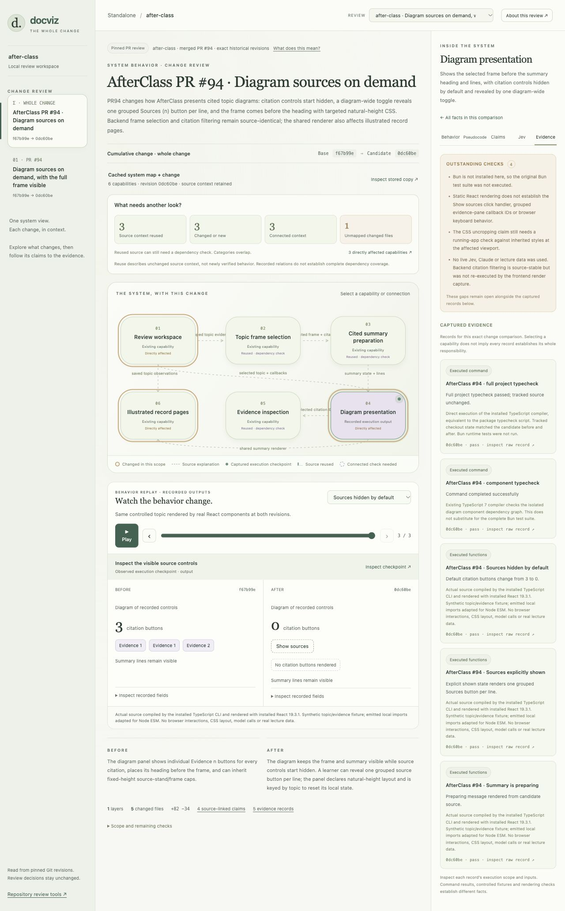

# Standalone studio validation

Recorded November 6, 2026. This is validation of the local prototype, not approval to merge a new candidate. The initial live Jev run completed on the original PR head. The updated source-context criteria require a fresh live rerun and independent merge review; those results belong to their exact tested revision.

## Executed checks

- Final repository checks: npm run check passed; npm test had 288 passes, 17 skips and no failures across 305 cases. The studio contributes 95 passing cases, including nested boundary cases. Covers exact comparison scopes, capture pairing, source/evidence integrity, cache persistence, immutable historical records, contract/source changes, downstream context, unmapped files, repository/base matching and HTTP/extension boundaries. The new suite includes regressions for delayed Jev responses after a property edit and explicit decisions for reserved object-property names.
- Existing Docviz suite before packaging: 193 passed, 17 skipped, no failures. Historical import caches were isolated. Skips concern unavailable TLC/statechart, rendering tooling and a local private fixture.
- Historical stack PRs #13–15: three regression commands, 43 passing cases, and 12 recorded function captures. Upstream findings are controlled fixtures.
- Docviz #16: 66 passed, 14 skipped, no failures. Actual isolated runPr executions select the decoy checkout at base and requested checkout at candidate, including relative steps/glossary files. Live provider/Jev and trusted-model execution are outside this capture.
- AfterClass #94: actual TypeScript-compiled React static renders at both revisions. Default citation buttons change from three to zero; the explicit shown state renders Sources (1) and Sources (2). Component typecheck and a separately recorded full-project typecheck pass. No Bun suite was run because Bun was unavailable. No real lecture data or live model calls were used.

The documented original-stack preparation and Docviz #16 trial also completed in a separate checkout with a new repository registration. Its baseline ID differs from the original local cache, and the overlay retains five reused descriptions and one changed description. No copied runtime state was needed.

## Browser validation

Computer Use exercised the standalone app at its actual desktop and narrow preview sizes. Checked whole-stack and local layers, review selection, reuse filters with surrounding context, component and connection inspection, pseudocode links to pinned Git blobs, claim expansion, Jev unavailability, raw captures, scenario switching and keyboard checkpoint selection. The user reviewed the new design and found it usable.

## Cache trials

Docviz #16 uses the exact cached tip of the earlier stack. Five descriptions retain source context, one changes, five provide connected context and four changed files are unmapped. AfterClass first receives a source-derived baseline, then PR94 overlays it. Three descriptions are reused, three change, three provide connected context and one changed test file is unmapped. Categories overlap. Map IDs depend on repository registration and content; examples do not pin another machine's ID.

Baseline maps are immutable. Candidate descriptions are proposed updates, separate from fresh claims and evidence. The cached Docviz entry-point anchor was imprecise; the proposed update links directly to runPr and flags its source correspondence for review.

## Open verification

- Jev live testing uses workspace properties. The stack view retains recorded status/questions. The initial results included an insufficient-context false flag; the updated gate and UI now need their exact-head live rerun and independent review.
- AfterClass needs live toggle, topic-reset, grouped evidence selection, focus/keyboard, saved-record and uncropped-layout checks. Static rendering proves markup, not interaction or CSS layout.
- The preparing text's usually 20–30 seconds claim has no captured timing measurement.
- Unchanged frame selection and backend citation filtering are source context, not new execution evidence.
- The supplied graphs and manually prepared models do not establish complete repository coverage or automatic modeling of arbitrary repositories.
- The existing verify-docviz skill covers the legacy PR CLI/helper, not this studio UI. Its independent merge verdict remains separate.

Runtime records, checkouts, credentials, CLI transcripts and generated extension bundles are ignored. Existing helper and documentation extension behavior remain available. The studio opens no PRs and merges nothing itself.

## Cache schema and source-context correction

Cache boundary regressions reproduced malformed allowed values being retained. The corrected validator rejects structured description fields, non-string ports, malformed nested records and source ranges before persistence. Reads reject correctly fingerprinted malformed graph records. Valid cached Docviz, Docviz PR16 and AfterClass PR94 snapshots still load with unchanged IDs. Cache regression file: 27 passing cases.

The source-context regression reproduced a high contradiction score becoming a contradiction despite insufficient source. The updated criteria ask about source sufficiency first. Low context becomes `uncertain`; malformed/missing scores remain `unknown`; adequate source retains the support and contradiction cutoffs. The adapter records criteria version, thresholds, scores, reason and the original property definition. Workspace regressions confirm uncertainty remains an evidence gap without creating a blocking contradiction, while a direct contradiction still does. Amber UI presentation retains earlier historical results unchanged.

Independent source review reproduced two further integrity problems. Out-of-file anchors could be marked reusable, and an altered inline capture could disagree with its immutable raw artifact. The corrected cache checks anchored blob ranges before storage or cached return. Replay loading now hydrates and validates captures through the same fingerprint-verifying loader as raw evidence. Eleven stack tests cover canonical replay and evidence cards, corruption, malformed records, scope and missing artifacts. Existing Docviz and AfterClass examples still load with unchanged map IDs and 12, 2 and 6 verified captures respectively. Final full suite: 288 passes, 17 skips, no failures.

The final residual evidence-card case is also covered: cards now use canonical artifact kind, commit, title, scope, summary and execution status. Unverified inline success claims cannot override a failing artifact. Inline layer associations survive only when the layer head matches the canonical commit. Existing examples retain their real status and scope.

## Behavior-first review

The workspace now prefers an exact-revision behavior bundle over the file-grouping graph. A directed system diagram names payloads, highlights the selected PR scope and opens a selected module's recorded input/output comparison. Claim, visual test oracle, pinned implementation/test blocks, related live source judgments and raw canonical captures appear on click. Whole-PR additions remain distinct from amendments inside a PR.

The PR18 adapter reruns three real exported-function cases at initial and candidate checkpoints. Git inspection confirms the base lacks a studio. Controlled scores and supplied records are labeled; no mock provider result is represented as live Jev evidence. Independent review reproduced and corrected historical-definition mislabeling, unrelated-module evidence leakage, fixed-length playback and unobserved-output success display. Browser validation covers the actual controls and both wide and narrow layouts. Full legacy merge-gate prerequisites remain documented separately; this prototype does not turn a matching scenario into module approval.
